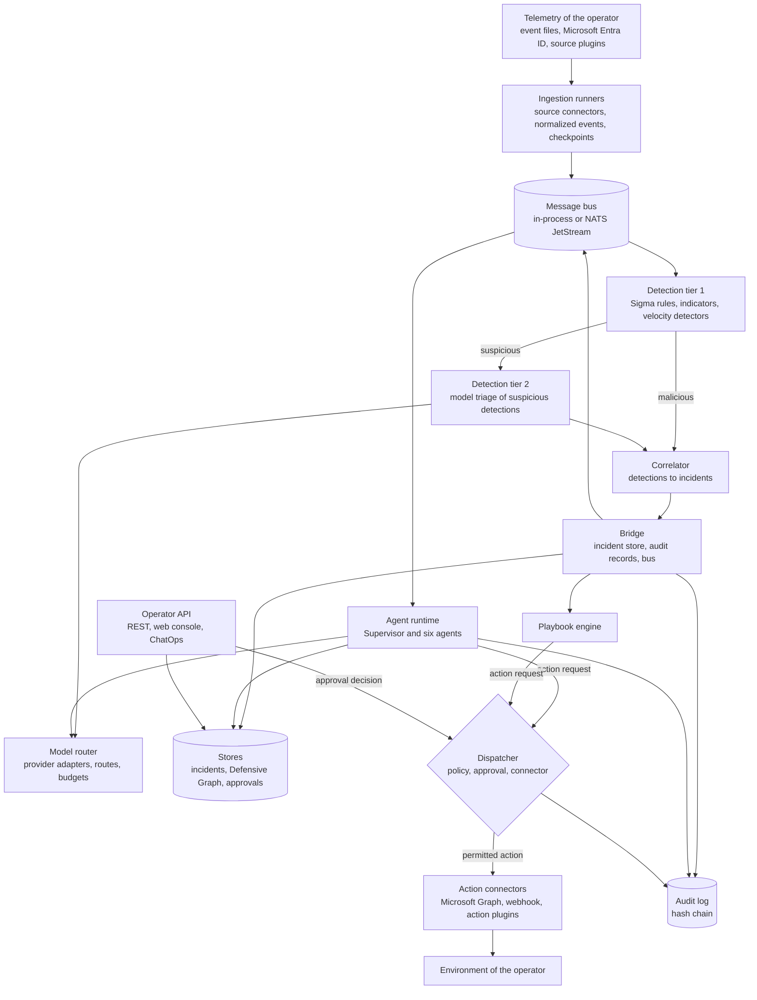

# AEGIS

[](https://github.com/onequbitaway/aegis/actions/workflows/ci.yml)
[](LICENSE)

AEGIS is an open-source framework for autonomous cyber defense, written in Rust. An
operator sets a defensive goal. AEGIS then reads the telemetry of the environment, finds
attacks, and proposes containment actions under the policy of the operator.

AEGIS is defensive only. Use it only in an environment that you own or have
authorization to defend.

> [!IMPORTANT]
> AEGIS has no release. You build it from the source code. With the default settings,
> each response action is a dry run, and AEGIS changes nothing in your environment. Read
> [Project status](#project-status) before you use it.

## Contents

- [Why AEGIS](#why-aegis)
- [What AEGIS does](#what-aegis-does)
- [Quickstart](#quickstart)
- [Project status](#project-status)
- [Architecture](#architecture)
- [Crate map](#crate-map)
- [Documentation](#documentation)
- [Repository layout](#repository-layout)
- [Scope and non-goals](#scope-and-non-goals)
- [Contributing](#contributing)
- [Security](#security)
- [License](#license)

## Why AEGIS

Attackers use agent frameworks to automate attacks. One example is ARTEX, an open-source
penetration test framework that threat actors use to run attack campaigns. These
campaigns operate with almost no human input. A human security team cannot respond at
that speed. Reports from [CERT-EU][cert-eu] and [Check Point Research][check-point]
describe these campaigns.

AEGIS gives defenders the same operation model. A deterministic fast path finds known
attack patterns in milliseconds. Agents then analyze the incident and propose the
containment. The operator owns the policy that decides each action.

## What AEGIS does

1. **Ingest.** Source connectors convert vendor telemetry to one normalized event.
2. **Detect.** Tier 1 is deterministic: Sigma rules, indicator matches, and velocity
   detectors, with no model. Tier 2 asks a model about the detections that tier 1 marks
   as `suspicious`.
3. **Correlate.** A correlator puts related detections in one incident and maps them to
   [MITRE ATT&CK][attack].
4. **Analyze.** A Supervisor and six agents share a Defensive Graph. They assess the
   incident and propose response actions. Each agent has a deterministic path, so AEGIS
   works with no model.
5. **Respond.** Each action goes through one path. The path has the [Rego][rego]
   policy, an approval by a person, an action connector, and the audit log.
6. **Record.** A hash-chained audit log records each decision and its evidence.

## Quickstart

The demonstration replays a recorded attack by an automated agent on an identity tenant.
It needs no model, no database, and no network. Each action is a dry run.

Prerequisites: Git, and [rustup][rustup].

1. Get the code, and install the pinned Rust toolchain.

   ```sh
   git clone https://github.com/onequbitaway/aegis.git
   cd aegis
   rustup toolchain install
   ```

2. Build the program. The first build compiles all dependencies and takes some minutes.

   ```sh
   cargo build -p aegis-cli --locked
   ```

3. Run the demonstration.

   ```sh
   ./target/debug/aegis demo
   ```

The command examines 648 events and prints the detections, the incident, the proposed
actions, and the result of the audit check. This is a part of the output:

```text
AEGIS demonstration: replay of the recorded attack log: 648 events, dry run, no model

Detections (8)
  2026-11-03T09:10:00.450Z  high           malicious   T1110.003               Sign-in burst from one address  [aegis.velocity.sign_in_burst]
  2026-11-03T09:10:31.000Z  high           malicious   T1078                   Successful sign-in after a sign-in burst  [aegis.velocity.sign_in_after_burst]
  2026-11-03T09:10:37.000Z  high           malicious   T1528                   Consent to privileged application permissions  [5b0f3c2e-8a41-4d6f-9c57-2e1a7b90d314]
  2026-11-03T09:10:40.000Z  high           malicious   T1098.001               New application credential immediately after a grant  [aegis.velocity.credential_after_grant]
  2026-11-03T09:10:46.000Z  high           malicious   T1098.003               Privileged role assigned by a workload identity  [a4d7e1b9-6c35-4f02-8e7a-1b9c0d5f2a63]
  2026-11-03T09:10:46.000Z  high           malicious   T1098.003               Workload identity gave itself a privileged role  [aegis.velocity.privileged_self_assignment]
  2026-11-03T09:10:52.000Z  high           malicious   T1078.004               Principal acts from two places at an impossible speed  [aegis.velocity.impossible_speed]
  2026-11-03T09:11:15.000Z  critical       malicious   T1552                   Honeytoken used  [0c9e4f7a-2b6d-4e18-a3f5-7d21c6b8e940]

Incidents (1)
  508657f7-d921-8cb3-add4-c2bd62528abd  critical       investigating   Multi-stage attack: 7 ATT&CK techniques in 8 detections

Actions (23)
  block_ip                    ip_address 203.0.113.50                         responder                                 executed: simulated (connector simulation)
  disable_service_principal   service_principal sp-sync-helper                responder                                 executed: simulated (connector simulation)
  revoke_credential           service_principal sp-sync-helper                responder                                 executed: simulated (connector simulation)
  No action changed the environment.

Audit log
  Records: 155
  Records checked: 155
  Chain: valid
```

The sample shows 3 of the 23 action lines.

Continue with [docs/quickstart.md](docs/quickstart.md). It explains the output, and it
shows the service, the web console, an approval, and the audit log.

## Project status

AEGIS has no release and no version tag. The program has the version `0.1.0`. Each crate
has automated tests. No external security audit was done.

### What works today

| Area | Function |
| --- | --- |
| Program | `aegis demo`, `init`, `run`, `replay`, `monitor`, `audit verify`, `audit show`, and `config check`. |
| Sources | A JSON Lines event file. Microsoft Entra ID sign-in and directory audit logs. WebAssembly source plugins. |
| Detection tier 1 | A subset of Sigma, indicators, four velocity detectors, and a honeytoken detector. |
| Detection tier 2 | Model triage of `suspicious` detections, with strict validation of each answer. |
| Correlation | Detections to incidents, with ATT&CK techniques and a severity. |
| Agents | Supervisor, Monitor, Hunter, Analyst, Responder, Deception, and Reporter. Each works with no model. |
| Models | Adapters for the OpenAI chat-completions format and for the Anthropic Messages API. A router with routes, fallback, and token budgets. |
| Response | One dispatcher: Rego policy, approval queue, connector, audit. YAML playbooks with a dry-run mode. |
| Action connectors | Microsoft Graph identity actions. Signed webhooks. WebAssembly action plugins. A honeytoken registry. |
| Policy and audit | Rego policy in the process, role-based access control, approval rules, and a hash-chained audit log in a file or in PostgreSQL. |
| Storage | In memory, or PostgreSQL with Apache AGE and pgvector. |
| Bus | In the process, or NATS JetStream. |
| Operator interface | A REST API, a web console, and Slack and Teams commands. |

These functions were also run by hand for the documents:

- All commands of the program.
- The service with the web console and an approval.
- The memory storage, the PostgreSQL storage, and the NATS bus.
- The example plugins.
- A local model on an Ollama server.

These functions have only the automated tests, which use mock servers:

- The Entra ID source and the Microsoft Graph connector against Microsoft Graph.
- The Anthropic adapter.
- The delivery of a webhook.
- Slack and Teams.

### What is not done

- **No release.** No packages and no signed binaries. You build from source.
- **Few connectors.** No connector for EDR products, firewalls, cloud platforms, or SIEM
  products. Use the webhook connector or a plugin for them.
- **No reload command.** The program reads the rule pack, the policy, and the playbooks
  at the start. A change needs a restart.
- **No access to reports.** The Reporter agent publishes each incident report on the
  bus. No command and no API route shows it.
- **No undo.** A connector can undo an action, but no command and no API route calls
  that function.
- **No TLS in the API server.** The server listens on a loopback address. For other
  access, put a proxy with TLS before it.
- **Some state is in memory.** The state of the velocity detectors and the honeytoken
  registry do not continue after a restart.
- **Parts that the program does not use.** The vector store and a function that makes a
  response plan with a model exist in the libraries.
- **Not in the default build.** gRPC is a Cargo feature that is off by default.
- **Not built.** A Kafka bus, and export in the full Open Cybersecurity Schema Framework.
- **No trace spans.** The trace exporter starts, but the components make no spans.

Each document in [`docs`](docs/README.md) has a section "Limits" with more details.

## Architecture

One process holds all components. A configuration file selects the components that run.



The design rules:

- **Deterministic first.** Tier 1 uses no model. A `malicious` tier 1 detection never
  goes to a model, and a model cannot change it.
- **One dispatch path.** No agent and no playbook calls a connector directly.
- **The operator owns the policy.** AEGIS has no rules of its own about targets or
  actions.
- **Fail closed.** With no valid policy decision, AEGIS denies the action. An action
  that the audit log cannot record does not run.
- **Safe defaults.** Each action is a dry run until the operator permits changes.
- **The model is not trusted.** The code validates each model answer. A model can only
  select optional actions from a list that the code makes.
- **Model-agnostic.** A hosted model, a gateway, or a local model works behind one
  interface. AEGIS also works with no model.

Refer to [docs/architecture.md](docs/architecture.md) for the data flow, the bus
subjects, the trust boundaries, and the threat model of AEGIS.

## Crate map

All crates are in `crates/`. A crate talks to a different subsystem only through
`aegis-contracts`.

| Crate | Function |
| --- | --- |
| [`aegis-contracts`](crates/contracts/src) | The frozen traits and types that all crates use. |
| [`aegis-core`](crates/core/README.md) | The configuration, the log, the module set, and the shutdown signal. |
| [`aegis-ingest`](crates/ingest/README.md) | Source connectors, the ingestion runner, and checkpoints. |
| [`aegis-bus`](crates/bus/README.md) | The message bus: NATS JetStream, or a bus in the process. |
| [`aegis-detect`](crates/detect/README.md) | Sigma rules, indicators, velocity detectors, model triage, and the correlator. |
| [`aegis-model`](crates/model/README.md) | Model provider adapters and the model router. |
| [`aegis-agents`](crates/agents/README.md) | The agent runtime and the seven agents. |
| [`aegis-respond`](crates/respond/README.md) | The dispatcher, the action connectors, the playbook engine, and honeytokens. |
| [`aegis-policy`](crates/policy/README.md) | The Rego policy engine, access control, the approval service, and the file audit log. |
| [`aegis-storage`](crates/storage/README.md) | PostgreSQL stores for the graph, the incidents, the audit log, and the approvals. |
| [`aegis-memory`](crates/memory) | Stores in the memory of the process. |
| [`aegis-plugin`](crates/plugin/README.md) | The sandbox for WebAssembly connector plugins. |
| [`aegis-api`](crates/api/README.md) | The REST API, the web console, and ChatOps. |
| [`aegis-app`](crates/app/README.md) | The composition root: builds all subsystems from one configuration. |
| [`aegis-cli`](crates/cli/README.md) | The `aegis` program. |
| [`aegis-testkit`](crates/testkit) | In-memory implementations of the contracts for tests. |

## Documentation

| Document | Contents |
| --- | --- |
| [docs/quickstart.md](docs/quickstart.md) | Build, the demonstration, the service, the console, an approval, and the audit log. |
| [docs/demo.md](docs/demo.md) | The recorded attack, step by step. |
| [docs/architecture.md](docs/architecture.md) | The components, the data flow, and the threat model. |
| [docs/configuration.md](docs/configuration.md) | Each key of `aegis.toml`, environment overrides, and secrets. |
| [docs/connectors.md](docs/connectors.md) | How to write a connector, native and as a plugin. |
| [docs/detection-packs.md](docs/detection-packs.md) | How to write and test detection rules. |
| [docs/playbooks.md](docs/playbooks.md) | How to write playbooks. |
| [docs/policy.md](docs/policy.md) | How to write the response policy. |
| [docs/operations.md](docs/operations.md) | How to operate the service, and troubleshooting. |
| [docs/security.md](docs/security.md) | The hardening checklist and the tested security properties. |
| [examples](examples/README.md) | Configuration sets that you can run. |

For deployment in containers, refer to [`deploy/README.md`](deploy/README.md).

## Repository layout

```text
.
├── .github/             CI workflow, Dependabot configuration, issue and PR templates
├── crates/              The Rust crates. Refer to the crate map.
├── deploy/              Files for deployment in containers
├── detections/          The detection pack that AEGIS ships
├── docs/                The documentation
├── examples/            Configuration sets that you can run
├── fixtures/            The recorded attack log for tests and the demonstration
├── playbooks/           The sample playbooks
├── plugins/             Example WebAssembly connector plugins, and the authoring guide
├── policies/            The default response policy and example policies
├── wit/                 The WIT interface of connector plugins
├── AGENTS.md            Rules for coding agents
├── CHANGELOG.md         Record of notable changes
├── CODE_OF_CONDUCT.md   Contributor Covenant 3.0
├── CONTRIBUTING.md      How to contribute
├── Cargo.toml           Workspace manifest and lint rules
├── LICENSE              MIT License
├── SECURITY.md          How to report a vulnerability
├── clippy.toml          Clippy configuration
└── rust-toolchain.toml  Pinned Rust toolchain
```

## Scope and non-goals

- This project ships defensive modules only.
- This project does not write or distribute offensive, exploitation, or counter-attack
  modules. This rule includes payloads, stubs, and examples.
- AEGIS only reads the telemetry of the operator. It does not scan or probe a system.
- A response action changes only the environment of the operator, through the
  administrative interface of the product.
- The operator owns the policy that controls each action.

Use AEGIS only in an environment that you own or have authorization to defend.

## Contributing

Contributions are welcome. Read [CONTRIBUTING.md](CONTRIBUTING.md) before you open a pull
request. All participants must obey the [Code of Conduct](CODE_OF_CONDUCT.md).

## Security

Do not open a public issue for a vulnerability. Read [SECURITY.md](SECURITY.md) for the
procedure. Read [docs/security.md](docs/security.md) for the hardening checklist.

## License

AEGIS is available under the [MIT License](LICENSE).

[attack]: https://attack.mitre.org/
[cert-eu]: https://cert.europa.eu/blog/from-penetration-testing-to-cyber-threat-beware-of-artex
[check-point]: https://research.checkpoint.com/2026/hacking-on-autopilot-inside-artex-cybercrime-campaigns/
[rego]: https://www.openpolicyagent.org/docs/policy-language
[rustup]: https://rustup.rs
