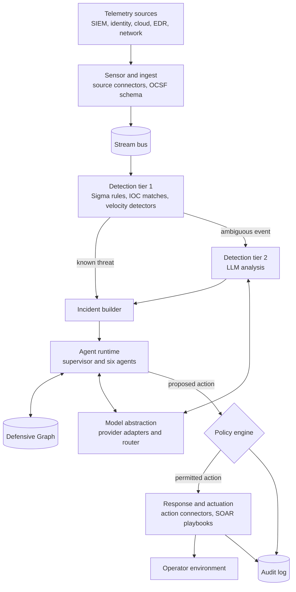

# AEGIS

[](https://github.com/onequbitaway/aegis/actions/workflows/ci.yml)
[](LICENSE)

AEGIS is an open-source framework for autonomous cyber defense. An operator sets a defensive
goal. A fleet of LLM agents then monitors the environment, finds attacks, and contains them at
machine speed.

> [!IMPORTANT]
> AEGIS is in the design phase. This repository contains the project scaffold only. The
> sections that follow describe the target design. You cannot use these functions at this time.

## Contents

- [Why AEGIS](#why-aegis)
- [Design goals](#design-goals)
- [Architecture](#architecture)
- [Technology](#technology)
- [Project status](#project-status)
- [Get started](#get-started)
- [Repository layout](#repository-layout)
- [Scope and non-goals](#scope-and-non-goals)
- [Contributing](#contributing)
- [Security](#security)
- [License](#license)

## Why AEGIS

Attackers use agent frameworks to automate attacks. One example is ARTEX, an open-source
penetration test framework that threat actors use to run attack campaigns. These campaigns
operate with almost no human input. A human security team cannot respond at that speed.
Reports from [CERT-EU][cert-eu] and [Check Point Research][check-point] describe these
campaigns.

AEGIS gives defenders the same operation model. The operator sets a goal. The agents then work
continuously to keep the environment safe.

## Design goals

1. **Model-agnostic.** All models work behind one interface: hosted models, gateways, and local
   models. The operator can select a different model for each task.
2. **Compatible with many tools.** Each telemetry input and each response action is a
   connector. Each connector converts vendor data to one common schema.
3. **Autonomous.** The operator sets the goals. The agents then run the observe, orient,
   decide, and act (OODA) loop continuously.
4. **Machine speed.** A deterministic fast path finds known threats in milliseconds without an
   LLM. The LLM analyzes only new or ambiguous events.
5. **Defensive only.** This project ships defensive modules only. Refer to
   [Scope and non-goals](#scope-and-non-goals).
6. **Modular.** Agents, connectors, detection packs, and policy are plugins. An operator can
   run only the monitor function or the full OODA loop.
7. **Air-gap capable.** The full system can operate offline with local models. The runtime is
   one static binary.

## Architecture

### Data flow



### Layers

| Layer                     | Function                                                                                             |
| ------------------------- | ---------------------------------------------------------------------------------------------------- |
| Interface                 | Web console, REST and gRPC API, CLI, ChatOps, and reports.                                           |
| Agent runtime             | A supervisor and six agents that share the Defensive Graph.                                          |
| Model abstraction         | Provider adapters, a model router, one schema for tool calls, and embeddings.                        |
| Detection and correlation | Sigma rules, IOC matches, velocity detectors, LLM analysis, and the incident builder.                |
| Policy and audit          | A policy engine, action tiers, human approvals, and the audit log. This layer applies to all others. |
| Sensor and ingest         | Source connectors that convert telemetry to the OCSF schema and put it on the stream bus.            |
| Response and actuation    | Action connectors and a SOAR engine that do containment actions in the operator environment.         |

### Agents

Each agent runs a loop. All agents read from and write to the Defensive Graph. The graph holds
assets, identities, alerts, findings, incidents, and their relations.

| Agent      | Task                                                                                  |
| ---------- | ------------------------------------------------------------------------------------- |
| Supervisor | Divides the goal of the operator into tasks.                                          |
| Monitor    | Monitors the live streams and keeps the situation picture current.                    |
| Hunter     | Hunts for threats and examines the external exposure of the assets of the operator.   |
| Analyst    | Triages alerts, adds context, finds false positives, and builds the case.             |
| Responder  | Proposes containment actions and does them through the actuation layer, under policy. |
| Deception  | Plants honeytokens and honeypots, and monitors them.                                  |
| Reporter   | Writes incident reports, timelines, and abuse or takedown packages.                   |

### Model abstraction

- One `ModelProvider` interface supplies chat, tool calls, streams, and embeddings.
- Each provider is one adapter. To add a model, write one adapter file.
- A router selects a model for each task: a fast model for triage, a strong model for incident
  analysis.
- The router applies budget limits. If a model fails or refuses a defensive task, the router
  uses a different model.

### Detection

Detection has two tiers:

1. **Tier 1, deterministic.** [Sigma][sigma] rules and indicator of compromise (IOC) matches
   classify known threats. This tier uses no LLM and has a latency of milliseconds.
2. **Tier 2, LLM analysis.** The LLM analyzes only the events that tier 1 cannot classify.

Velocity detectors find the burst patterns of an agent attack:

- A sign-in burst, for example thousands of sign-ins in one minute.
- An application that assigns a privileged role to itself.
- A credential change on an application immediately after a grant.
- Activity across tenants at a speed that is not possible for a person.

AEGIS maps each detection to [MITRE ATT&CK][attack]. A correlator combines signals from many
sources into one incident.

### Response

Action connectors are the output equivalent of source connectors. A SOAR engine runs YAML
playbooks for known incidents. For a new incident, the LLM writes a draft response.

The operator assigns each action to a tier:

| Tier  | Actions                                                                   | Approval                                  |
| ----- | ------------------------------------------------------------------------- | ----------------------------------------- |
| Auto  | Safe and reversible: enrich, tag, notify, snapshot evidence.              | None.                                     |
| Gated | Disruptive: disable a service principal, isolate a host, rotate a secret. | Policy check and optional human approval. |

Each playbook has a dry-run mode.

### Policy and audit

- The policy engine evaluates [Rego][rego] policy in the AEGIS process. No sidecar is necessary.
- The operator writes the policy. The policy sets which actions run automatically, which
  actions must have approval, and which actions are not permitted.
- The audit log records each agent decision, the evidence for it, and each action.
- A hash chain makes changes to the audit log easy to find.
- Each action has a link to its evidence.

## Technology

| Area          | Selection                                                                                |
| ------------- | ---------------------------------------------------------------------------------------- |
| Language      | Rust for the full runtime. No Python in the runtime.                                     |
| Event schema  | [OCSF][ocsf].                                                                            |
| Storage       | PostgreSQL with [Apache AGE][age] for the graph and [pgvector][pgvector] for embeddings. |
| Stream bus    | [NATS JetStream][jetstream]. Kafka is an optional connector.                             |
| Policy        | Rego, with the [regorus][regorus] engine.                                                |
| Observability | [OpenTelemetry][otel].                                                                   |
| Plugins       | Connectors are WASM components. Detections are Sigma YAML files.                         |
| Deployment    | Containers and Kubernetes.                                                               |

## Project status

| Phase | Work                                                                                            | Status      |
| ----- | ----------------------------------------------------------------------------------------------- | ----------- |
| 0     | Repository scaffold: workspace, lint rules, CI, and project documents.                          | Complete    |
| 1     | Contracts: the shared traits and types that all crates compile against.                         | Not started |
| 2     | Subsystems: model layer, ingest, detection, agent runtime, response, policy and audit, storage. | Not started |
| 3     | Integration and end-to-end tests.                                                               | Not started |
| 4     | Interface, packages, documentation, and examples.                                               | Not started |

The first end-to-end milestone is a demonstration that runs offline with a local model and a
mock source:

1. AEGIS replays a recorded attack log.
2. The detection tiers build the correct incidents.
3. A containment playbook runs in dry-run mode.
4. The audit log records each step.

## Get started

You can build and test the workspace at this time. The workspace has no functions that you can
run.

Prerequisites:

- Git
- [rustup][rustup]

Steps:

1. Clone the repository.

   ```sh
   git clone https://github.com/onequbitaway/aegis.git
   cd aegis
   ```

2. Install the Rust toolchain that `rust-toolchain.toml` pins.

   ```sh
   rustup toolchain install
   ```

3. Build and test the workspace.

   ```sh
   cargo build --workspace
   cargo test --workspace
   ```

## Repository layout

```text
.
├── .github/             CI workflow, Dependabot configuration, issue and PR templates
├── crates/
│   └── contracts/       aegis-contracts: shared traits and types (empty at this time)
├── AGENTS.md            Rules for coding agents
├── CHANGELOG.md         Record of notable changes
├── CODE_OF_CONDUCT.md   Contributor Covenant 3.0
├── CONTRIBUTING.md      How to contribute
├── Cargo.toml           Workspace manifest and lint rules
├── LICENSE              MIT License
├── SECURITY.md          How to report a vulnerability
├── clippy.toml          Clippy configuration
└── rust-toolchain.toml  Pinned Rust toolchain
```

## Scope and non-goals

- This project ships defensive modules only.
- This project does not write or distribute offensive, exploitation, or counter-attack modules.
- AEGIS does containment actions in the environment of the operator.
- The operator owns the policy that controls each action.

Use AEGIS only in an environment that you own or have authorization to defend.

## Contributing

Contributions are welcome. Read [CONTRIBUTING.md](CONTRIBUTING.md) before you open a pull
request. All participants must obey the [Code of Conduct](CODE_OF_CONDUCT.md).

## Security

Do not open a public issue for a vulnerability. Read [SECURITY.md](SECURITY.md) for the
procedure.

## License

AEGIS is available under the [MIT License](LICENSE).

[age]: https://age.apache.org/
[attack]: https://attack.mitre.org/
[cert-eu]: https://cert.europa.eu/blog/from-penetration-testing-to-cyber-threat-beware-of-artex
[check-point]: https://research.checkpoint.com/2026/hacking-on-autopilot-inside-artex-cybercrime-campaigns/
[jetstream]: https://docs.nats.io/nats-concepts/jetstream
[ocsf]: https://schema.ocsf.io/
[otel]: https://opentelemetry.io/
[pgvector]: https://github.com/pgvector/pgvector
[rego]: https://www.openpolicyagent.org/docs/policy-language
[regorus]: https://github.com/microsoft/regorus
[rustup]: https://rustup.rs
[sigma]: https://sigmahq.io/
