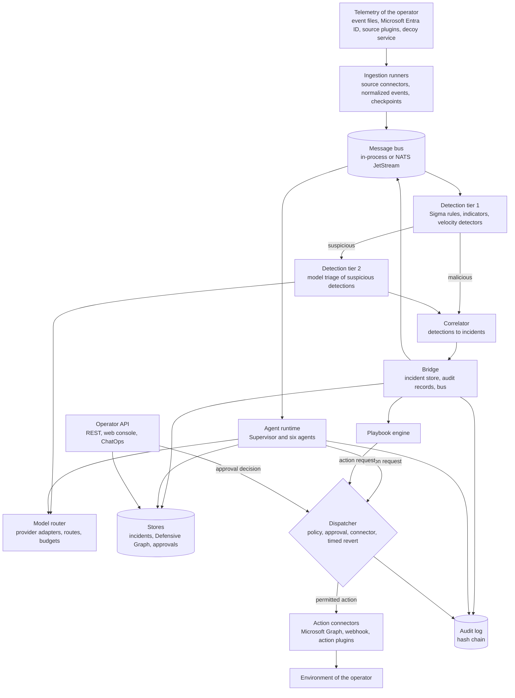
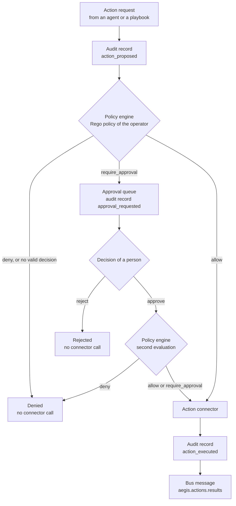

# Architecture

This document describes the components of AEGIS, the data flow between them, and the
trust boundaries. It also gives the threat model of AEGIS itself.

AEGIS is defensive only. Each response action changes only the environment of the
operator, through an administrative interface that the operator configures.

## Contents

- [Overview](#overview)
- [Layers and crates](#layers-and-crates)
- [Data flow](#data-flow)
- [Bus subjects and payloads](#bus-subjects-and-payloads)
- [The two detection tiers](#the-two-detection-tiers)
- [The agents](#the-agents)
- [The single dispatch path](#the-single-dispatch-path)
- [Storage options](#storage-options)
- [Run modes](#run-modes)
- [Trust boundaries](#trust-boundaries)
- [Threat model of AEGIS](#threat-model-of-aegis)
- [Limits](#limits)

## Overview

One process, the `aegis` program, holds all components. A configuration file selects the
components that run.

## Layers and crates

Each subsystem is one crate in `crates/`. A crate talks to a different subsystem only
through the contracts of `aegis-contracts`.

| Layer | Crate | Function |
| --- | --- | --- |
| Contracts | `aegis-contracts` | The shared traits and types: events, connectors, detections, incidents, actions, policy, the audit log, the graph, and the bus. |
| Platform | `aegis-core` | The configuration file, environment overrides, the log and the trace exporter, the module set, and the shutdown signal. |
| Sensor and ingest | `aegis-ingest` | Source connectors, the ingestion runner, and checkpoints. |
| Stream bus | `aegis-bus` | The message bus: NATS JetStream, or a bus in the process. |
| Detection and correlation | `aegis-detect` | Sigma rules, indicators, velocity detectors, model triage, flood protection, and the correlator. |
| Deception | `aegis-decoy` | The decoy service: a tarpit, a maze, a decoy model API, and a canary instruction. |
| Model abstraction | `aegis-model` | Provider adapters and the model router. |
| Agent runtime | `aegis-agents` | The Supervisor, six agents, and their guard rails. |
| Response and actuation | `aegis-respond` | The dispatcher, the revert scheduler, the action connectors, the playbook engine, and honeytokens. |
| Sharing | `aegis-share` | Abuse reports and indicator exports. The crate makes documents only. |
| Policy and audit | `aegis-policy` | The Rego policy engine, role-based access control, the approval service, and the file audit log. |
| Storage | `aegis-storage`, `aegis-memory` | PostgreSQL stores, and stores in the memory of the process. |
| Plugins | `aegis-plugin` | The sandbox for WebAssembly connector plugins. |
| Interface | `aegis-api`, `aegis-cli` | The REST API, the web console, ChatOps, and the `aegis` program. |
| Composition | `aegis-app` | Builds all subsystems from one configuration and connects them. |
| Tests | `aegis-testkit` | In-memory implementations of the contracts, and the recorded attack log. |

## Data flow

The steps below are the steps of the service (`aegis run`).

1. **Ingest.** One ingestion runner drives each source connector. The connector converts
   vendor records to the normalized `Event`. The runner publishes each event on
   `aegis.events.{connector}` and then saves the cursor of the connector.
2. **Detect.** The detection runner reads `aegis.events.>` with a durable name. Tier 1
   examines each event. Tier 2 examines only the detections with the verdict
   `suspicious`, and only if a model is configured.
3. **Correlate.** The correlator puts related detections in one incident.
4. **Record.** The bridge writes one audit record for each detection and for each change
   of an incident. It writes the incident to the incident store. Then it publishes the
   detections on `aegis.detections.{tier}` and the stored incident on `aegis.incidents`.
5. **Analyze.** The agent runtime reads `aegis.incidents`. The agents write to the
   Defensive Graph, assess the incident, and propose response actions.
6. **Respond.** The agents and the playbook engine send each action request to the one
   dispatcher. Refer to [The single dispatch path](#the-single-dispatch-path).
7. **Operate.** The operator API reads the stores and the audit log. It sends each
   approval decision and each revert decision to the dispatcher path.

Three more parts run beside these steps:

- **The decoy service.** With the `[decoy]` section, one decoy listens for clients that
  have no permission. It is a source connector, so its events go through steps 1 to 6.
  Refer to [deception.md](deception.md).
- **The revert scheduler.** With the `[response.revert]` table, the scheduler reverts each
  action with a revert time, unless a person confirms it. Each revert is a request to the
  dispatcher. Refer to [response.md](response.md).
- **The evidence archive.** With the `[evidence]` section, the bridge writes each
  detection with its events to a file. The incident store writes each state of an
  incident to the same file. The sharing commands read the file. Refer to
  [sharing.md](sharing.md).

The ingestion runner publishes a batch before it saves the cursor. After a stop between
the two steps, the runner sends the batch again. The runner can repeat an event. It does
not lose an event. A detection identifier comes from the rule and the events, so a
repeated event gives the same detection.

## Bus subjects and payloads

Each payload is JSON. The types are the types of `aegis-contracts`.

| Subject | Payload | Publisher | Readers in the process |
| --- | --- | --- | --- |
| `aegis.events.{connector}` | `Event` | Each ingestion runner | The detection runner |
| `aegis.detections.deterministic` | `Detection` | The bridge | The live feed of the API, `aegis monitor` |
| `aegis.detections.llm` | `Detection` | The bridge | The live feed of the API, `aegis monitor` |
| `aegis.incidents` | `Incident` | The bridge | The agent runtime, the live feed, the ChatOps notifications |
| `aegis.agents.tasks.{role}` | `AgentTask` | A component that gives work to an agent | The agent runtime |
| `aegis.actions.requests` | `ActionRequest` | The agent runtime, before the dispatch | None |
| `aegis.actions.results` | `ActionResult` | The dispatcher only | The live feed |
| `aegis.approvals` | `ApprovalRequest` | The dispatcher (new request), the application (decision) | The live feed, the ChatOps notifications |
| `aegis.audit` | `AuditRecord` | The audit log of the application | The live feed |
| `aegis.reports.{incident}` | `ReportDocument` | The Reporter agent | None |

Rules of the bus:

- A subject has tokens with `.` between them. A pattern can use `*` for one token and `>`
  for all tokens that remain.
- A subscriber with a durable name continues after its last message when it starts again.
  Delivery to a durable name is at least once.
- Each durable subscriber of the process has its own name. The defaults are `aegis-detect`
  for the detection runner, and `aegis-agents-tasks` and `aegis-agents-incidents` for the
  agent runtime.
- The bus publishes the stored state of an incident, not the state of the detection
  engine. A subscriber thus never sees an incident that goes back to `open`.

## The two detection tiers

| | Tier 1 | Tier 2 |
| --- | --- | --- |
| Method | Deterministic: Sigma rules, indicator matches, velocity detectors, the honeytoken detector | A model examines one detection and its event |
| Uses a model | No | Yes |
| Input | Each event | Only a tier 1 detection with the verdict `suspicious` |
| Result | A detection with the tier `deterministic` | A detection with the tier `llm` |

- A tier 1 detection with the verdict `malicious` never goes to the model. The correlator
  gets it immediately.
- An event with no detection never goes to the model.
- The output of the model is not trusted. An answer that is not valid keeps the detection
  `suspicious`. A model failure never removes a detection and never makes it `benign`.
- With no `[model]` section, tier 2 does not run. Each `suspicious` detection goes to the
  correlator as it is.

The velocity detectors are a part of the engine. They operate with each detection pack:

| Detector | Pattern |
| --- | --- |
| `sign_in_burst` | Many failed sign-ins from one address in a short time, and a sign-in that succeeds after the burst. |
| `privileged_self_assignment` | A workload identity gives a privileged role or permission to itself. |
| `credential_after_grant` | A new application credential a short time after a consent or a permission grant. |
| `impossible_speed` | One principal acts from two places at a speed that is not possible. |
| `machine_cadence` | One principal or one address does a chain of different sensitive actions at a speed or a regularity that a person does not have. |
| `endpoint_probe` | One client asks an endpoint for many paths that do not exist, or for one decoy path. |

The engine also protects itself from a flood of events:

- A rule can give one detection for one key in a window.
- Tier 2 has a quota of model requests.
- One incident has a limit on its states in a window.

Refer to [configuration.md](configuration.md#detection).

The correlator puts two detections in one incident when they are in the same tenant,
share an entity, and are in one time window. The severity of an incident is the largest
severity of its detections. An incident with three or more ATT&CK techniques is
`critical`.

Refer to [detection-packs.md](detection-packs.md).

## The agents

Each agent works on tasks. All agents share the Defensive Graph and the incident store.
An agent proposes an action. An agent never changes the environment.

| Agent | What it does | With no model |
| --- | --- | --- |
| Supervisor | Turns the goal of the operator into tasks. Gives new incidents to the Monitor. | The default plan: one task for the Monitor, the Hunter, and the Deception agent. |
| Monitor | Writes incidents, alerts, entities, and their relations to the Defensive Graph. | Always deterministic. |
| Hunter | Examines the graph and the incident store. Records findings. | The deterministic hunts: shared address, privileged role, external exposure. |
| Analyst | Assesses an incident. Sets the state, the summary, and the timeline. | A `malicious` tier 1 detection or a honeytoken use confirms the incident. Each other incident stays `open`. |
| Responder | Proposes containment actions and records each result. | The baseline actions for each entity type. |
| Deception | Proposes honeytokens. Escalates an incident when a honeytoken is used. | Always deterministic. |
| Reporter | Writes the incident report as JSON and as Markdown. | A deterministic template. |

The module set selects the agents. An agent runs only if its module is in `[modules]`.
The Supervisor runs when one agent module or more is in the set.

Guard rails of the runtime:

- One external input can cause only a limited number of tasks for one incident.
- The tasks of one incident run one at a time.
- With `agents.dry_run`, the runtime sets `dry_run` on each proposed action. An agent
  cannot switch the dry run off.
- The runtime dispatches each action with a principal of the type `agent`. The identifier
  and the single role of the principal are the role name of the agent.
- An agent error, a panic, or a timeout goes to the audit log. The runtime continues.

## The single dispatch path

Each action request goes through one `Dispatcher`. No agent, playbook, or API route
calls a connector directly.

Rules of the path:

- **Audit first.** A request that the audit log cannot record does not run.
- **Fail closed.** An error of the policy engine or of the incident store is a denial.
- **The policy is the authority.** AEGIS has no rules of its own about targets or
  actions. The dispatcher writes each policy decision to the audit log.
- **One approval, one action.** An approved request runs one time. A failed call also
  uses the approval.
- **Policy again.** The dispatcher evaluates the policy a second time before it runs an
  approved action. A new denial stops the action.
- **Global dry run.** With `response.dry_run`, the dispatcher sets `dry_run` on each
  request, also on an approved one. A connector then changes nothing.
- **Time limit.** A connector call that does not complete in the execution timeout is an
  error.
- **Routing.** The routing table selects the connector for an action type. With no line
  for the type, the first connector that supports the type does the action.
- **Revert.** A revert is a request of its own, with the action type `{custom: revert}`.
  It goes through the same path. One execution can be reverted one time.
- **Timed revert.** A request with a revert time runs only if the dispatcher can keep the
  pending revert in its store. The connector must also be able to undo the action.

Refer to [policy.md](policy.md) and [playbooks.md](playbooks.md).

## Storage options

| Data | `kind = "memory"` | `kind = "postgres"` |
| --- | --- | --- |
| Incidents | In the process. Gone after a stop. | The table `aegis.incidents`. |
| Defensive Graph | In the process. Gone after a stop. | The Apache AGE graph `aegis_graph`. |
| Approval queue | In the process. Gone after a stop. | The table `aegis.approvals`. |
| Embeddings | In the process. | pgvector tables. |
| Audit log | Not applicable. Refer to the next table. | Not applicable. Refer to the next table. |

| Audit log | Storage | Checked by |
| --- | --- | --- |
| `audit.kind = "file"` | One append-only JSON Lines file. One process writes it. | `aegis audit verify`, and the API route `GET /api/v1/audit/verification`. |
| `audit.kind = "postgres"` | The table `aegis.audit_log`. Triggers reject each update and each removal. | The API route `GET /api/v1/audit/verification`. |

| Bus | Storage | Use |
| --- | --- | --- |
| `bus.kind = "memory"` | In the process. Gone after a stop. | One process with no NATS server. |
| `bus.kind = "nats"` | A NATS JetStream stream. | Durable messages. |

The starter configuration uses the memory storage, the memory bus, and the file audit
log. `audit.kind = "postgres"` needs `storage.kind = "postgres"`.

These parts are in the memory of the process with each storage option:

- The state of the velocity detectors and of the correlator.
- The honeytoken registry, and the receiver of rotated secrets.
- The record of which playbook ran for which incident.
- The events of the decoy that the detection engine did not examine.

These parts are files with each storage option:

- The pending timed reverts (`response.revert.store`).
- The evidence archive (`evidence.path`).

Refer to [operations.md](operations.md) for the effects of a restart.

## Run modes

| Command | Components | Actions |
| --- | --- | --- |
| `aegis run` | The modules of the configuration, as a service. | As the configuration and the policy permit. |
| `aegis replay` | Detection, agents, playbooks, and the dispatcher, on one event file. No source connector. | As the configuration permits. With `--dry-run`, dry runs only. |
| `aegis demo` | The same as `replay`, on the recorded attack log, in a new starter directory. | Dry runs only. |
| `aegis monitor` | Ingestion, detection, and the Monitor agent, on one event file. | None. |
| `aegis reverts` | None. The command calls the operator API of a running service. | A revert decision of a person. |
| `aegis report abuse`, `aegis indicators export` | None. The commands read the audit log and the evidence archive. | None. They write documents. |

Only `aegis run` starts the decoy service and the revert scheduler.

A replay gives the same result each time for the same events and the same configuration.

## Trust boundaries

| Boundary | What crosses it | Control |
| --- | --- | --- |
| Source system to source connector | Vendor records | The Entra ID connector uses HTTPS, follows no redirect, and refuses a next-page link to a different host. |
| Event text to the model | Text that an attacker can write, for example a user agent | A prompt puts untrusted text only in marked data sections. The code validates each model answer. |
| AEGIS to the model server | Detections, events, and incident data | The operator selects the provider. A local model keeps the data on the host. |
| Plugin to host | Events, action outcomes, and HTTP requests of a plugin | The WebAssembly sandbox. Refer to [connectors.md](connectors.md#the-sandbox). |
| Action request to the environment | A change in the environment of the operator | The dispatcher: policy, approval, audit. |
| Operator to the API | Decisions, goals, and playbook runs | A bearer token for each principal, role-based access control, and the approval rules. |
| Unknown client to the decoy | Requests of a client that has no permission | The decoy has hard limits for connections, sizes, and times. It opens no connection. Its events hold client text only as data. |
| AEGIS to a different organization | Abuse reports and indicators | The commands write files and send nothing. They mask operator data and refuse to run with no operator networks. A person reads each file. |
| Process to the files | The policy, the rule pack, the playbooks, the audit file | The permissions of the operating system. AEGIS records the policy digest in the audit log. |

## Threat model of AEGIS

AEGIS has the right to change the environment of the operator. An attacker thus has two
goals against AEGIS: to stop a detection, and to cause a harmful action. This section
states what a compromised part can do and what it cannot do.

### A compromised telemetry source or source connector

It can:

- Send false events. False events can cause false detections and action requests.
- Hold back events. AEGIS then does not see the activity.
- Put text in event fields that tries to instruct the model.

It cannot:

- Run an action. Each action request goes through the policy of the operator.
- Skip an approval. With the default policy, each action in the gated tier that is not a
  dry run needs the approval of a person.
- Change the audit records of the detections that it caused.

A native source connector is code in the AEGIS process. It has all the rights of the
process. Run only native connectors that you trust. A source plugin is in the sandbox.

### A compromised plugin

It cannot:

- Read a file, read an environment variable, or open a socket.
- Send an HTTP request to a host that is not in `allowed_hosts` of its manifest.
- Use more memory or more time than the limits of the host.
- Emit an event in the name of a different connector. The host sets the connector name.
- Report a change for a dry run. The host refuses that outcome.
- Stop the host. A trap in a plugin is an error of that one call.

It can:

- Send false events, as each source can.
- Report a false result for a real action, for example success with no change.
- Send the data that it gets to a host in `allowed_hosts`.

Pin each component with `sha256` in its manifest. Give each plugin only the hosts that it
needs.

### A compromised model, or a successful prompt injection

It cannot:

- Make an action. The code makes the list of candidate actions. The model can only select
  optional actions from that list, for entities of the incident.
- Skip the dispatcher, the policy, or an approval.
- Switch the dry run off.
- Make a `malicious` tier 1 detection `benign`. Such a detection never goes to the model.
- Close an incident that has deterministic evidence of an attack.
- Change a fact of an incident report. The code makes the facts.

It can:

- Give a `suspicious` detection the verdict `benign`, if it states a confidence at or
  above `benign_min_confidence`.
- Close an incident that has only `suspicious` detections as a false positive, if it
  states a confidence at or above `analyst.false_positive_min_confidence`.
- Add optional actions to a response, which the policy then decides.
- Write the summary and the recommendations of a report.
- Read the data that AEGIS sends to it.
- Use the token budget, or give no answer. The agents then use their deterministic paths.

To limit this risk, keep the important rules at the level `high` or `critical`, so that
their detections are `malicious`. Set a token budget. Use a local model for data that
must not leave the host.

### A changed policy file, rule pack, or playbook

The policy file decides which actions run with no person. A person or a program that can
write the policy file controls the actions of AEGIS.

It can:

- Permit each action with no approval.
- Deny each action, so that AEGIS contains nothing.

It cannot:

- Open a network connection or read the environment of the process. The policy engine
  has no such functions.
- Change the policy with no trace. AEGIS writes the digest of the policy to the audit
  log at each start. Compare the digest with the digest of the file that you approved.

A changed rule pack can remove a detection. A changed playbook can add action requests,
which the policy then decides. A file that is not valid stops the start of AEGIS.

Protect these files with the permissions of the operating system. Keep them in version
control.

### A changed audit log

- A changed record, a removed record, and a record in a different position break the
  hash chain. The check names the first record that is not correct.
- A file audit log that lost its last records is still a correct chain. To find this,
  keep the sequence number and the hash of the last record in a different system.
- An account with write access to the audit file can replace the full file with a new
  correct chain. The hash chain does not prevent that. Use the external copy of the last
  hash, or the PostgreSQL audit log with an application role that can only add records.

### A client of the decoy

A client of the decoy controls its requests: the path, the headers, and the prompt.

It can:

- Cause detections and an incident for its own address. The policy then decides each
  response action.
- Put text in event fields that tries to instruct a model. A prompt puts this text only
  in marked data sections.
- Use the connections of the decoy up to the limits.

It cannot:

- Reach the operator API through the decoy. The two listeners have different addresses.
- Make the decoy open a connection, call a model, or send data of the operator.
- Use memory or time above the limits of the decoy.
- Select a response action. Text of a client never selects an action.

### A stolen API token

A token gives the permissions of the roles of its principal. A token with
`approve_actions` can approve a gated action, confirm a timed revert, and request a
revert. The four-eyes rule stops a principal that approves its own request. Refer to [security.md](security.md) for the hardening steps.

## Limits

- The only built-in source connectors are the event file source and the Microsoft Entra
  ID source. The only built-in action connectors for external systems are the Microsoft
  Graph connector and the webhook connector.
- The normalized event uses class names of the Open Cybersecurity Schema Framework. It is
  a small schema of its own, not the full framework.
- The Hunter agent examines only data that AEGIS has. It connects to no asset. The
  repository has no inventory connector that writes exposure data to the graph.
- A honeytoken action records a decoy in a registry. It does not plant the decoy in a
  vault.
- One process runs one decoy. The decoy has no TLS.
- The revert store and the evidence archive are files. They have no PostgreSQL form.
- The sharing commands write files. AEGIS sends no report and no indicator.
- The Reporter agent publishes each report on the bus. No command and no API route shows
  a report.
- The vector store exists. No agent uses embeddings.
- A function that makes a response plan with a model exists in `aegis-respond`. The
  `aegis` program does not use it.
- The message bus has no Kafka implementation.
- gRPC is not in the default build. Refer to the README of `aegis-api`.
